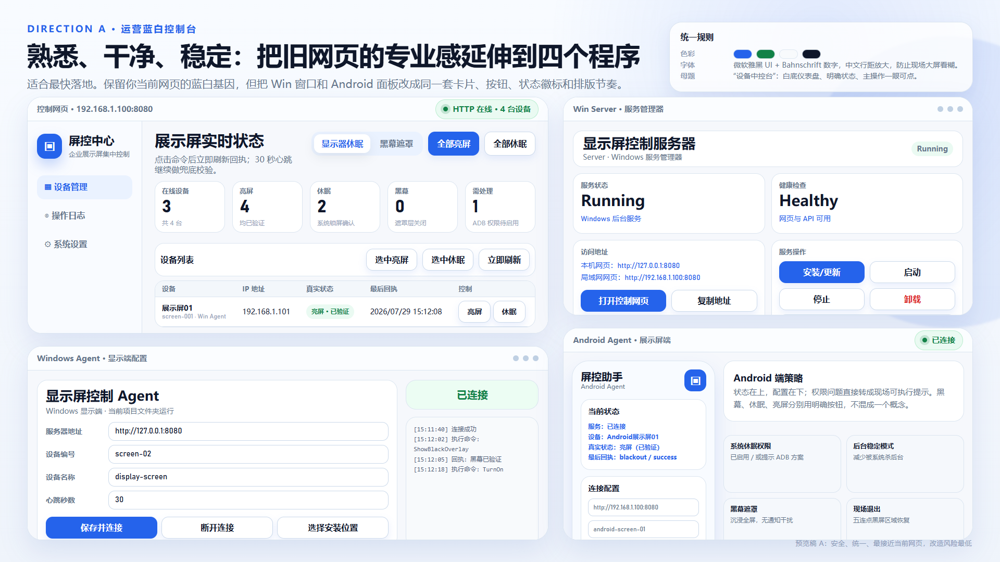

# DisplayControl 展示屏集中控制系统

> 在可信局域网内，通过一个控制网页统一管理 Windows 与 Android 展示屏的亮屏、休眠和黑幕状态。

项目面向公司展厅、会议室和一体机等固定设备场景。仓库包含控制网页、Windows Server、
Windows Agent、Android Agent、安装脚本、测试和发布工具；普通使用者可以直接使用发布包，
开发者也可以从源码复现构建。

适合需要在可信局域网内集中管理多台展示终端、同时要求操作简单和状态回执清晰的团队。
最短使用路径是从 GitHub Releases 下载完整包，解压后直接运行 Server Manager 和对应 Agent。

当前版本：**2026.08.03.1 直接运行版**

- Server 11.7.0（Windows 服务兼容名：`DisplayControlCenterV11`）
- Windows Agent 16.6
- Android Agent 1.6.9



## 项目亮点

- **四端完整交付**：控制网页、Windows Server 管理端、Windows Agent 和 Android Agent 使用统一的操作逻辑与视觉语言。
- **状态不是按钮猜测**：命令区分已发送、已接收、已执行和已验证，网页以 Agent 回执更新设备状态。
- **连续控制可收束**：亮屏、休眠和黑幕命令有明确结果，避免按钮长期停留在“发送中”。
- **局域网登录保护**：管理员登录包含图形验证码、CSRF 防护和单一管理设备会话限制。
- **解压即可运行**：Windows Server Manager 与 Windows Agent 为自包含单文件 EXE，配置和数据保存在项目目录。
- **可继续维护**：仓库包含源码、构建脚本、核心回归、发布烟测、中文文档和版本记录。

## 30 秒了解项目

| 组件 | 运行位置 | 主要职责 |
| --- | --- | --- |
| 控制网页 | 随 Server 发布 | 登录、设备状态、批量控制、操作日志 |
| Windows Server 管理端 | 管理电脑 | 后台服务、网页/API、安装和维护 |
| Windows Agent | Windows 展示端 | 亮屏、休眠、黑幕和状态回执 |
| Android Agent | Android 展示端 | 亮屏请求、系统锁屏/休眠、全屏黑幕和状态回执 |

项目会区分命令的“已发送、已接收、已执行、已验证”，不会仅根据按钮点击推测设备真实状态。

## 工作方式

```text
浏览器控制台
    │ HTTP + SignalR
    ▼
DisplayControl Server
    ├─ SignalR ── Windows Agent ── Windows 显示设备
    └─ HTTP 轮询 ─ Android Agent ─ Android 展示设备
```

Server 负责登录、设备登记、命令协调、状态汇总和操作日志。Windows Agent 使用 SignalR
保持实时连接；Android Agent 使用兼容现场设备的 HTTP 轮询。控制网页由 Server 直接提供，
不需要单独部署前端服务。

## 快速使用

不需要开发环境时，使用 GitHub Releases 中的 `DisplayControlProject-*-full.zip`：

1. 解压完整包，先阅读 `先看这里-安装说明.txt`。
2. 打开 `01-安装包` 中的 Server 文件夹，双击 `DisplayControl.Server.Manager.exe`，选择安装位置并安装 Server。
3. 在管理器中打开初始密码文件，再打开控制网页完成首次登录和改密。
4. Windows 展示端双击 `DisplayControl.Agent.exe`；Android 展示端安装 `DisplayControlAndroidAgent-v1.6.9.apk`。
5. Agent 中填写 Server 所在电脑的局域网地址，例如 `http://192.168.1.100:8080`。

普通使用者不需要直接打开 `.ps1` 文件。

## 已验证状态

- .NET Release 构建：0 警告、0 错误。
- 核心协议与安全回归：11/11 通过。
- 发布包 HTTP、登录、会话、命令和并发烟测：39/39 通过。
- 20 台模拟 SignalR Agent、600 次心跳：失败 0 台。
- Server Manager 与 Windows Agent 单文件 EXE 启动测试通过。
- Android APK 元数据与 v1/v2 签名验证通过。

完整验证范围和仍需真机确认的部分见[当前测试报告](docs/TEST_REPORT_CURRENT.md)。

## 安全使用范围

当前版本用于受信任的公司局域网，不应直接暴露到互联网：

- 默认通信为 HTTP；跨不可信网络部署时应增加 HTTPS 反向代理或 VPN。
- 兼容模式可允许旧 V15/Android V1.5 Agent 匿名接入，正式部署应关闭不需要的兼容入口。
- 初始管理员密码会在每次新安装时随机生成，并要求首次登录后修改。
- `data/`、`.env*`、数据库、凭据、签名密钥和本地证书已排除在 Git 跟踪范围外。

安全问题请按照 [SECURITY.md](SECURITY.md) 的方式报告。

## 从源码构建

### 环境要求

- Windows 10/11 x64
- .NET SDK 10.0.302（由 `global.json` 固定）
- JDK 17 或更高版本
- Android SDK Platform 35
- PowerShell 5.1 或 PowerShell 7
- Node.js 20+（仅 SignalR 压力测试需要）

建议把仓库克隆到只包含 ASCII 字符的路径，避免 Android Gradle 在 Windows 中文路径下报错。

### .NET 构建与测试

```powershell
dotnet restore .\DisplayControl.slnx --locked-mode
dotnet build .\DisplayControl.slnx -c Release --no-restore
dotnet run `
  --project .\tests\DisplayControl.Contracts.Tests\DisplayControl.Contracts.Tests.csproj `
  -c Release `
  --no-restore
```

### Android 构建

```powershell
Set-Location .\src\DisplayControl.AndroidAgent
.\gradlew.bat :app:assembleDebug
```

### 生成完整发布包

`Build-Release.ps1` 默认从 PATH 和标准环境变量解析工具，不依赖某台电脑的固定盘符：

```powershell
.\scripts\Build-Release.ps1
```

可选环境变量：

- `DISPLAYCONTROL_WORKSPACE`：把缓存和发布装配输出放到仓库外的指定目录。
- `JAVA_HOME`：JDK 根目录。
- `ANDROID_SDK_ROOT`：Android SDK 根目录。
- `GRADLE_USER_HOME`：Gradle 缓存目录。
- `NUGET_PACKAGES`：NuGet 缓存目录。

本项目仍支持通过脚本参数显式指定本机工具路径。完整流程见
[开发、测试与发布指南](docs/DEVELOPMENT_AND_RELEASE.md)。

## 项目结构

```text
DisplayControl/
├─ src/                 # 四个正式程序与共享协议源码
├─ tests/               # 核心回归、命令链路和压力测试
├─ packaging/           # 发布包入口与安装脚本模板
├─ scripts/             # 构建、测试与发布脚本
├─ docs/                # 架构、部署、版本和测试文档
├─ design-demos/        # 已确认 UI 方向的预览材料
├─ design-system/       # 四端统一 UI 规范
├─ tools/diagnostics/   # 独立诊断工具，不属于正式程序
└─ third_party/         # 旧兼容成品的来源说明，不跟踪旧 APK
```

`bin/`、`obj/`、`build/`、`.gradle/`、`.workspace/` 和 `releases/` 均为可重新生成内容，
不会提交到 Git。

## 文档

- [项目概览](docs/PROJECT_OVERVIEW.md)
- [目录与文件职责](docs/PROJECT_STRUCTURE.md)
- [完整项目清单](docs/PROJECT_MANIFEST.md)
- [开发、测试与发布指南](docs/DEVELOPMENT_AND_RELEASE.md)
- [版本更新说明](docs/VERSION_NOTES.md)
- [当前测试报告](docs/TEST_REPORT_CURRENT.md)
- [GitHub 仓库资料](docs/GITHUB_REPOSITORY_PROFILE.md)
- [GitHub 上传前检查清单](docs/GITHUB_UPLOAD_CHECKLIST.md)
- [全部文档索引](docs/README.md)

## 贡献

提交 Issue 或 Pull Request 前请先阅读 [CONTRIBUTING.md](CONTRIBUTING.md)。代码标识符使用英文，
用户文档和界面文本使用中文；功能改动必须同步测试、版本说明和四端兼容性说明。

## 来源与维护边界

该项目依据旧版发布成品的可观察行为重建为可维护源码，不声称恢复了 V10/V15/V1.5 的原始源码。
旧成品仅用于协议兼容和回归参考，不进入当前发布流程。

## 许可证

仓库目前尚未选择开源许可证。在添加正式 `LICENSE` 前，默认保留全部权利；请勿把“可以查看源码”
理解为“可以任意复制、修改或再分发”。公开仓库前应由项目所有者选择合适的许可证。
